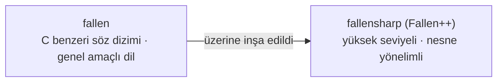

## 👋 Hakkımda

Merhaba, ben **Berat** (nickim **7YokKi**). İstanbul'dan, sistemin en alt katmanından programlama dillerinin kendisine kadar uzanan projeler geliştiriyorum.

- 🧠 Sıfırdan **çekirdek (kernel)** yazıyorum: C + ASM
- 🔤 Kendi **programlama dillerimi** tasarlıyorum: Rust ile yazılmış *Fallen* ve *Fallen++*
- 🌐 **P2P** sunucu yazılımları ve Go / Java ile mod entegrasyonları geliştiriyorum
- 🎵 Günlük hayatı kolaylaştıran araçlar yapıyorum: Python, C++

## 🚀 Projelerim

### 🖥️ Öne çıkan: NP Kernel

 

<table>
<tr>
<td></td>
<td></td>
</tr>
<tr>
<td></td>
<td></td>
</tr>
<tr>
<td></td>
<td></td>
</tr>
</table>

### 🔗 Fallen ekosistemi

<b>📋 Proje özetleri</b>

 

| Proje | Dil | Açıklama |
|-------|-----|----------|
| [NP-Kernel-OSP](https://github.com/7yokki/NP-Kernel-OSP) | C / ASM | NP Kernel v0.8, C ve ASM ile yazılan saf bir çekirdek projesi |
| [fallen](https://github.com/7yokki/fallen) | Rust | C ailesi benzeri söz dizimine sahip kodlama ve genel programlama dili |
| [fallensharp](https://github.com/7yokki/fallensharp) | Rust | Fallen üzerine yazılan yüksek seviyeli, nesne yönelimli dil (Fallen++) |
| [alterfy](https://github.com/7yokki/alterfy) | Python | yt-dlp ve VLC kullanan bağımsız bir Spotify alternatifi |
| [smsinecraft](https://github.com/7yokki/smsinecraft) | Go + Java | Modernize P2P sunucu yazılımı; sunucular Go, istemciler Fabric modu ile bağlanır |
| [gpimage](https://github.com/7yokki/gpimage) | C++ | Temel görsel upscaling gibi işlemler yapabilen yazılım |

## 🛠️ Teknolojiler

## 📊 GitHub İstatistikleri

